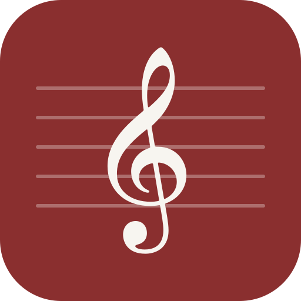
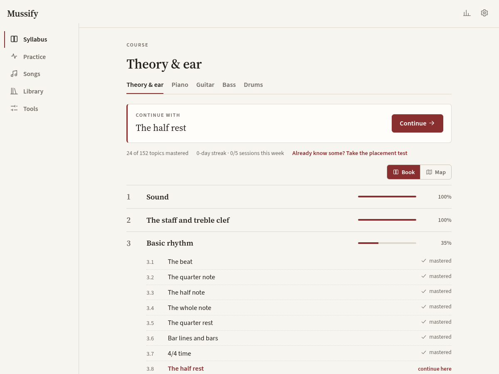
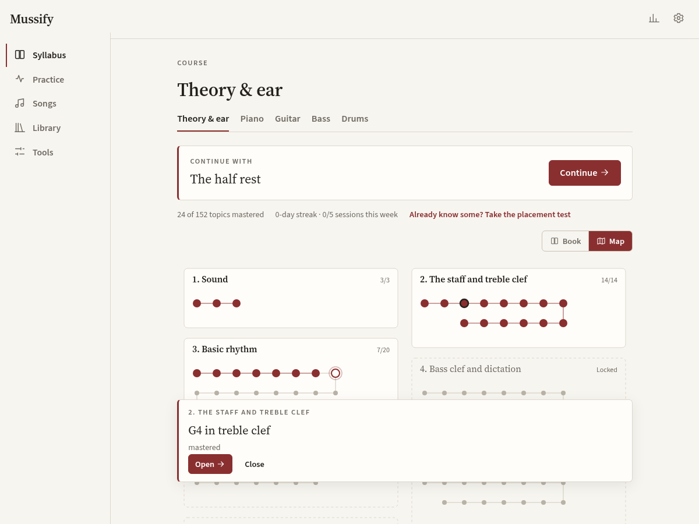
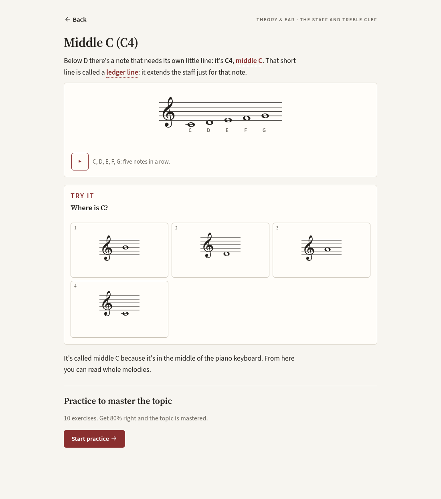
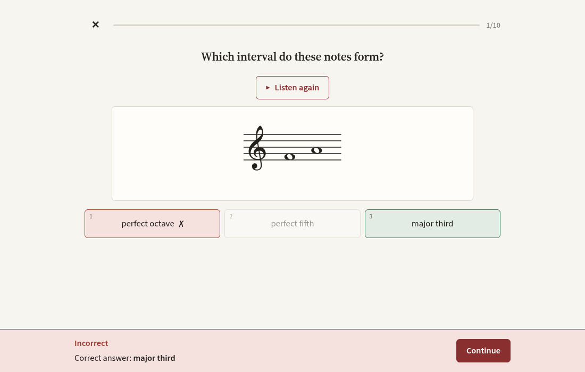
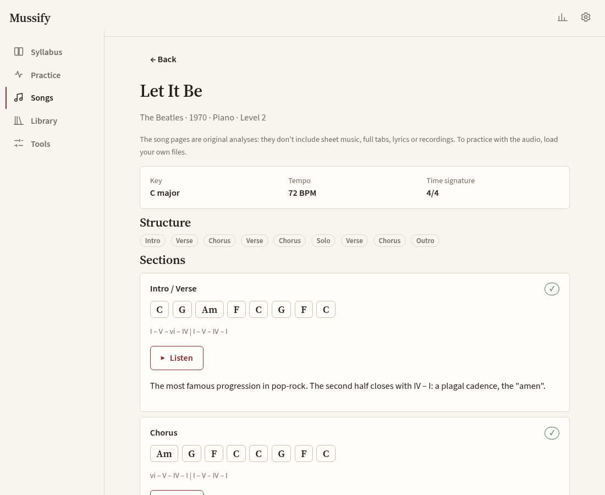
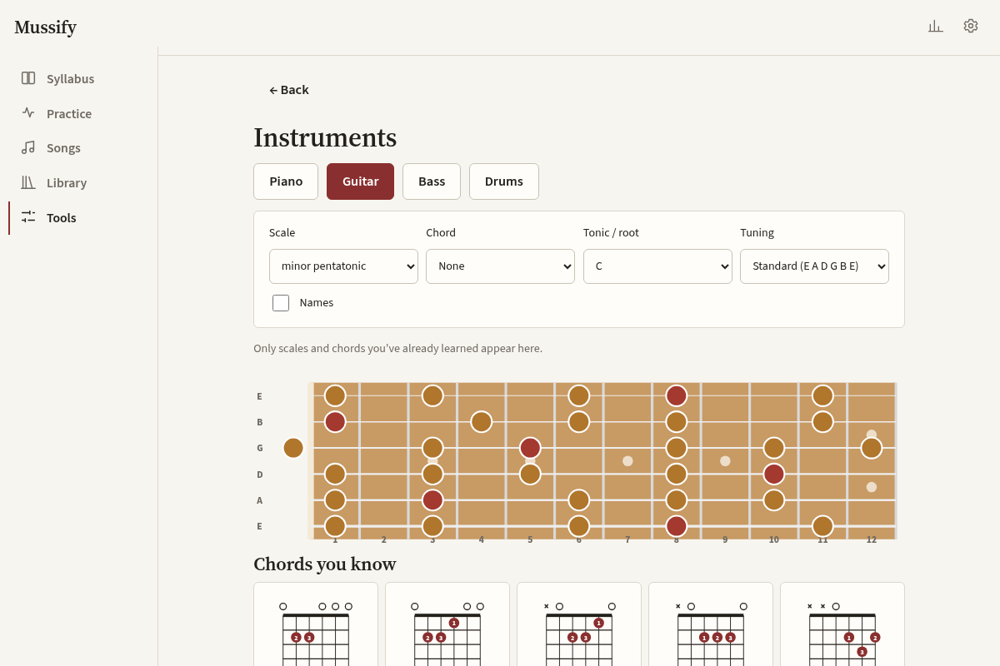
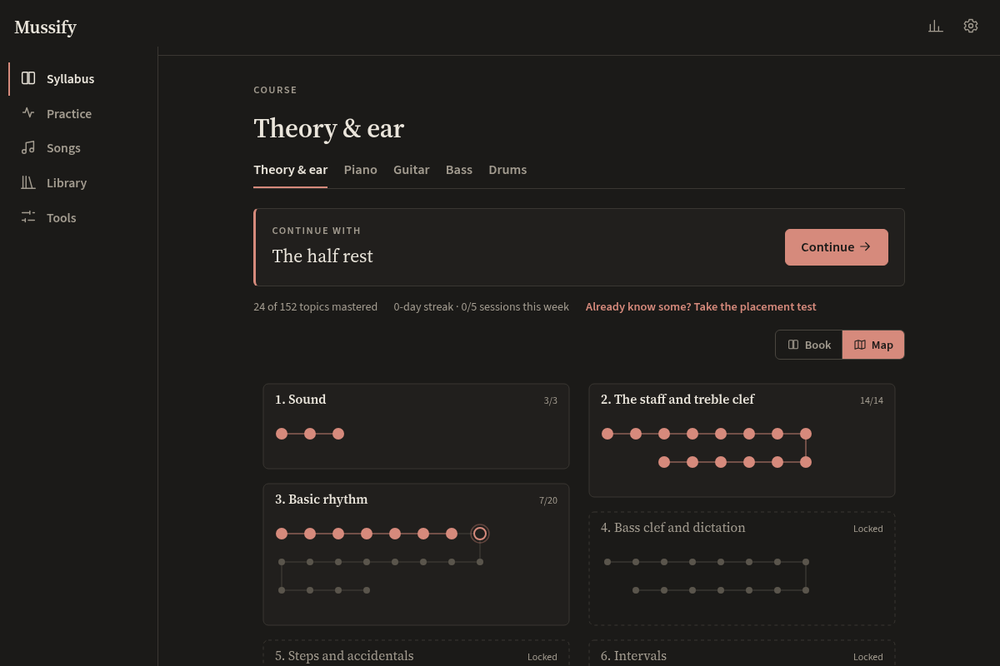
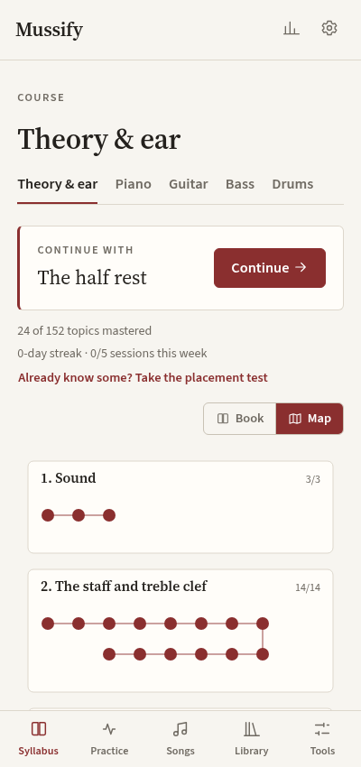

# Mussify

**English** · [Español](README.es.md)

**A free, offline app to learn music**: read notation, understand how notes sound, train your ear, theory from zero to advanced harmony, and rock songs on **piano, guitar, bass and drums**.

For Linux and Android, from a single codebase. **No accounts, no cloud, no telemetry.** Licensed GPL-3.0-or-later.

## Screenshots

| Syllabus (book) | Syllabus (map) |
|---|---|
|  |  |

| Lesson with an inline exercise |
|---|
|  |

| Exercise | Song page |
|---|---|
|  |  |

| Instruments | Dark mode | Phone |
|---|---|---|
|  |  |  |

## Features

- **Syllabus as a book or a map** (numbered chapters and topics with their mastery percentage, or a map of connected topics) with five branches: *Theory & ear* (common trunk, 152 lessons), *Piano*, *Guitar*, *Bass* and *Drums* (289 lessons in total).
- **Strictly linear progression**: each lesson teaches **one** concept; nothing shows up before it's learned (no notes, note values, chords, or terms in the texts). This is verified by tests over every lesson and by an audit that runs in the app before each exercise.
- **Randomly generated exercises** (seeded) weighted toward what you miss most: note reading, finding notes on the keyboard or fretboard, intervals, chords, scales, key signatures, degrees and functions, progressions by ear, melodic and rhythmic dictation, tab, chord diagrams, drum grooves, and more.
- **Note recognition by ear, without a reference**, woven into the reading lessons and getting harder as you learn (from "is this G?" to any note in any octave), plus **tap-the-staff** exercises.
- Sessions never repeat a question back to back and mix different kinds of exercises.
- **Spaced repetition** (SM-2) and "what you miss most" practice.
- **Optional placement test** per branch: unlocks only what you prove you know.
- **Built-in notation engine**: staff (treble, bass, C and percussion clefs), tab and drums, with playback, cursor, adjustable tempo and bar looping.
- **On-screen instruments** with free samples: piano (touch, mouse or computer keyboard), guitar (alternate tunings, left-handed), 4- and 5-string bass, drum pads.
- **Metronome** (simple, compound and odd meters, subdivisions, accents, tap tempo).
- **Library**: import MIDI, MusicXML, Guitar Pro (.gp3/.gp4/.gp5/.gpx/.gp), plain-text tabs and audio (mp3, ogg, flac, wav, m4a). If a file contains things you haven't learned yet, the app tells you and offers a simplified view (melody only, dim the unknown parts) or to keep it for later.
- **Learn songs by ear**: player with A-B loop, **speed change without pitch change**, EQ and filters to isolate lows/mids/highs, markers and personal notes by timestamp.
- **Local audio analysis**: tempo, approximate meter, key, chords and sections, all on your device; editable by hand.
- **Search and download audio with yt-dlp** (Linux), only when you ask, with confirmation, behind the network switch and recorded in the log.
- **12 song pages** with original analyses (structure, progressions, key, main device, linked theory): *Let It Be*, *Bohemian Rhapsody*, *Muchacha ojos de papel*, *Smoke on the Water*, *De música ligera*, *Wish You Were Here*, *Another One Bites the Dust*, *Come Together*, *Money*, *We Will Rock You*, *Back in Black*, *Rock and Roll*. They unlock section by section as you learn what's needed.
- **Low-key progress**: streak, weekly goal, accuracy by exercise type, history, "what you miss most" and a practice journal. No lives, leagues or coins.
- **Settings**: language, C D E / Do Re Mi / both, light/dark theme, interface size, high contrast, color-blind palette, reference pitch (A4 = 440 Hz by default), network, encrypted backup, storage used.
- Interface and lessons in **English** (default) and **Rioplatense Spanish**; switch in *Settings → Language*. All texts are externalized.

## Installation

Ready-made builds (AppImage and signed APK, with SHA-256 checksums) are on the [Releases](../../releases) page.

### Linux (CachyOS / Arch)

```bash
sudo pacman -S --needed rust nodejs npm webkit2gtk-4.1 alsa-lib base-devel
# optional, to download audio:
sudo pacman -S yt-dlp ffmpeg
git clone <this repository> mussify && cd mussify
scripts/build-linux.sh            # builds, runs the tests and makes deb/rpm/AppImage
./target/release/mussify          # or install the package from target/release/bundle/
```

Binary only, no packages: `npm ci && npx tauri build --no-bundle`.

### Android

Requires the Android SDK + NDK and JDK 17.

```bash
rustup target add aarch64-linux-android armv7-linux-androideabi x86_64-linux-android i686-linux-android
scripts/build-android.sh --debug  # debug APK
adb install src-tauri/gen/android/app/build/outputs/apk/universal/debug/app-universal-debug.apk
```

The APK only requests the `INTERNET` permission (on Android, yt-dlp downloads are not available; files are imported with the system picker).

## Development

```bash
npm ci
npm run tauri dev        # desktop app with hot reload
npm run dev              # UI only, in the browser (WebAudio sound, data in localStorage)
npm test                 # tests for the core, progression, content (both languages) and importers
MUSSIFY_SEEDS=60 npm test   # more seeds for the progression audit
cargo test --workspace   # audio, DSP, analysis, database, backup
npm run check            # TypeScript and Svelte types
```

In browser development mode, `?demo=N` marks the first N concepts as mastered, `?view=lesson&id=read.treble.C4` opens a view directly and `?lang=es-AR` forces the language.

Lesson content lives in `src/content/en/` and `src/content/es-AR/` (same lesson ids and examples), UI strings in `src/i18n/`. Each language has its own controlled vocabulary in `src/content/terms.ts`, so the tests catch any technical term used before it's taught.

## Privacy and network

See [`PRIVACY.md`](PRIVACY.md). To audit for yourself that there are no connections: `scripts/net-audit/run.sh target/release/mussify` (intercepts `connect()` in the app and all its child processes).

## Documentation

The technical docs are written in Spanish:

- [`ARCHITECTURE.md`](ARCHITECTURE.md): modules, data flow and extension points (MIDI, microphone, composition).
- [`DECISIONS.md`](DECISIONS.md): stack choice and other technical decisions.
- [`THIRD_PARTY.md`](THIRD_PARTY.md) and [`docs/dependencies.md`](docs/dependencies.md): licenses.
- [`PRIVACY.md`](PRIVACY.md), [`CONTRIBUTING.md`](CONTRIBUTING.md), [`packaging/README.md`](packaging/README.md).

## Third-party material

Mussify does not include copyrighted scores, full tabs, lyrics or recordings. The song pages are original analyses. Downloading and using third-party material is the responsibility of whoever does it and is meant for personal practice.

## License

GPL-3.0-or-later. See [`LICENSE`](LICENSE).
